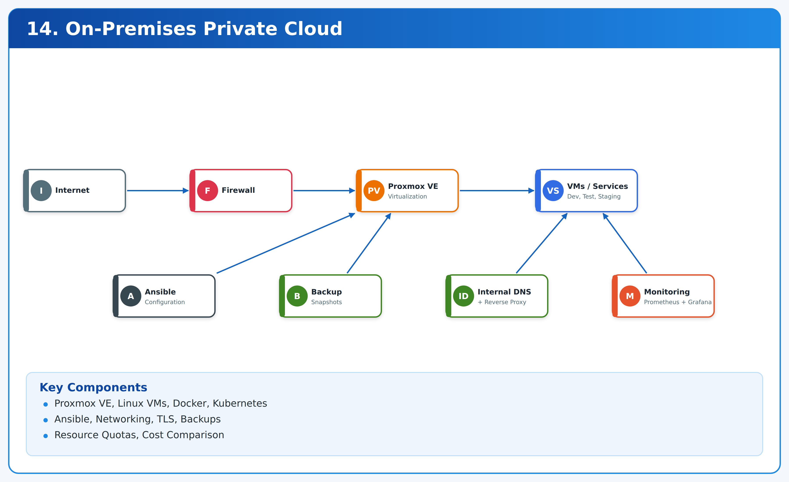

# On-Prem Private Cloud Platform

Private lab on existing server: Proxmox VE + Linux VMs + Docker (+ optional k3s) for dev / test / staging / internal tools.

Provisioning: Terraform (Proxmox VMs, cloud-init) + Ansible (base, Docker, k3s, registry, reverse-proxy, monitoring).
Platform services: private registry, reverse proxy with TLS, internal DNS, quotas, snapshots, backups + restore tests, Prometheus + Grafana.

> No `git init` / push done by scaffolder. Reviewed for valid YAML/HCL. Tested: `python3 scripts/cost-compare.py`, `pytest tests/`.

## Topology



```text
                    +------------------ INTERNET ------------------+
                    |  ISP Router (port 80/443 -> Proxmox host)   |
                    +----------------------+---------------------+
                                           |
                    +----------------------+----------------------+
                    | PROXMOX VE 8.x (pve-01, 192.168.1.10)       |
                    |  vmbr0: WAN/LAN bridge  vmbr1: 10.10.0.0/24 |
                    |  ZFS / LVM-thin + PBS / NFS backups         |
                    +----------------------+----------------------+
                                           | vmbr1 (10.10.0.0/24, VLAN-aware)
          +--------------------------------+--------------------------------+
          |                                 |                               |
+---------+---------+           +-----------+-----------+       +-----------+-----------+
| tools 10.10.0.10  |           | dev   10.10.0.21-.23  |       | test  10.10.0.31-.32  |
| traefik :80/:443  |           | docker / k3s agents   |       | docker / k3s agents   |
| registry :5000    |           | apps under test       |       | QA, preview           |
| gitea, portainer  |           |                       |       |                       |
| prometheus,grafana|           |                       |       |                       |
| coredns/dnsmasq:53|           |                       |       |                       |
+---------+---------+           +-----------+-----------+       +-----------+-----------+
          |                                 |                               |
          |                   +-------------+-------------+                 |
          |                   | staging 10.10.0.41-.42  |                 |
          |                   | prod-like, quotas, TLS  |                 |
          |                   +-------------------------+                 |
          +--------------------------------+--------------------------------+
                                           |
                              +--------------------------+
                              | PBS / NAS 10.10.0.5      |
                              | vzdump, borg, snapshots  |
                              +--------------------------+
```

DNS: `*.lab.home.arpa` -> `10.10.0.10` (traefik). Internal DNS: dnsmasq/CoreDNS on `tools`. TLS: mkcert internal CA for `*.lab.home.arpa` + Let's Encrypt on edge if public domain exists. See `docs/` and `ansible/roles/reverse-proxy/`.

## Hardware Requirements

| Tier | CPU | RAM | Disk | NIC | Notes |
|------|-----|-----|------|-----|-------|
| Minimum lab (1 node) | 8c / 16t | 64 GB ECC preferred | 2x 1TB NVMe ZFS mirror + 4TB HDD | 1x 1GbE (2x better) | Runs all 6-8 VMs thin-provisioned |
| Recommended (1 node) | 12-16c | 128 GB | 2x 2TB NVMe mirror + 2x 4TB HDD mirror | 2x 1GbE or 10GbE | ZFS ARC + PBS datastore local |
| HA (3 nodes) | 8c each | 64 GB each | NVMe + shared PBS/NFS | 10GbE | Ceph only if 10GbE + 3 nodes |

Enable VT-x/AMD-V, VT-d/IOMMU, AES-NI. UPS mandatory. 150-250W typical draw — used in cost model.

OS: Proxmox VE 8.x (Debian 12 base). ISO + Ventoy USB. ZFS RAIDZ/mirror for VM store, ext4/xfs for PBS datastore if separate disk.

## Quickstart

1. Install Proxmox — `docs/PROXMOX_SETUP.md`.
2. Configure Terraform + cloud-init template:
   ```bash
   cd terraform/proxmox
   cp terraform.tfvars.example terraform.tfvars  # create from variables.tf
   terraform init && terraform plan && terraform apply
   ```
3. Provision:
   ```bash
   ansible-galaxy collection install community.docker ansible.posix
   ansible-playbook -i ansible/inventory.ini ansible/site.yml
   ```
4. Platform compose (on `tools`):
   ```bash
   docker compose -f docker/compose.yml up -d
   ```
5. Optional k3s: `ansible-playbook -i ansible/inventory.ini ansible/site.yml --tags k3s`, then `kubectl apply -f k8s/`.
6. Backups: `bash scripts/backup.sh`; test restores: `bash scripts/restore-test.sh`.
7. Cost comparison: `python3 scripts/cost-compare.py --help`.

## VM Matrix

| Name | IP | vCPU/RAM/Disk | OS | Purpose | Provisioner |
|------|----|---------------|----|---------|-------------|
| tools | 10.10.0.10 | 4/16GB/100GB | Debian 12 cloud-init | traefik, registry, gitea, portainer, prometheus, grafana, dnsmasq | tf + ansible |
| dev-01, dev-02 | 10.10.0.21,.22 | 4/16GB/80GB | Debian 12 | dev workloads, docker/k3s agents | tf + ansible |
| test-01 | 10.10.0.31 | 4/16GB/80GB | Debian 12 | CI runners, QA | tf + ansible |
| staging-01 | 10.10.0.41 | 4/16GB/80GB | Debian 12 | prod-like, quotas enforced | tf + ansible |
| pbs (optional LXC/VM) | 10.10.0.5 | 2/4GB/500GB+ | Debian/PBS | Proxmox Backup Server datastore | manual/tf |

All VMs thin-provisioned, qemu-guest-agent on, snapshots before Ansible runs. See `terraform/proxmox/variables.tf` to resize.

## Networking / DNS / TLS

- Bridges: `vmbr0` (LAN/DHCP or static, gateway), `vmbr1` (isolated `10.10.0.0/24`, no internet NAT except via host firewall if desired).
- Firewall: Proxmox datacenter firewall default DROP; open 22, 80, 443, 853/53 (DNS), 9090/3000 (metrics, VPN-only).
- Internal DNS: dnsmasq on `tools` (`*.lab.home.arpa -> 10.10.0.10`). Set DHCP option 6 or per-host `/etc/hosts` fallback. `inventory.ini` uses IPs so DNS is optional for Ansible.
- TLS: dev assumes mkcert CA (`reverse-proxy` role generates + trusts). If you own a domain, set `traefik_acme_email` and enable Let's Encrypt in `docker/compose.yml`.

## Backups

- Proxmox `vzdump` nightly (snapshot mode) to PBS/NFS + `scripts/backup.sh` for Docker volumes (borg/restic pattern).
- Retention: 7 daily / 4 weekly / 6 monthly. Monthly `restore-test.sh` boots clone in isolated bridge and curls healthchecks.
- Full runbook: `docs/BACKUP_RESTORE.md`.

## Monitoring

Prometheus (15s scrape) + Grafana + node-exporter + cadvisor + alertmanager-ready `alerts.yml`. Targets: `tools`, `dev-*`, `test-*`, `staging-*`, traefik, registry. Dashboard: `monitoring/grafana-dashboard.json`. Alert on node down, disk >85%, OOM, TLS expiry <21d.

## Cost Comparison Method

`scripts/cost-compare.py` computes:

```text
monthly_onprem = hardware_cost / amort_months + power_kwh * $/kWh + internet_fraction + maintenance
monthly_cloud  = sum(AWS/DO equivalent instances + EBS + LB + registry + monitoring + egress)
savings = cloud - onprem
```

Defaults: $3500 server / 48 mo, 180W @ $0.18/kWh, $20/mo ISP share. Cloud map: `t3.xlarge`-class per VM + 100GB gp3 + ALB + ECR. Override via flags / JSON. Methodology + worked example: `docs/COST_MODEL.md`. CI runs `tests/test_cost_compare.py`.

## Repo Layout

```text
ansible/            inventory + site.yml + roles (base,docker,k3s,registry,reverse-proxy,monitoring)
terraform/proxmox/  bpg/proxmox VMs + cloud-init
docker/compose.yml  registry, traefik, portainer, gitea
k8s/                namespaces + ResourceQuotas
monitoring/         prometheus.yml, alerts.yml, grafana dashboard
scripts/            backup.sh, restore-test.sh, cost-compare.py
docs/               PROXMOX_SETUP, BACKUP_RESTORE, COST_MODEL
.github/workflows/  lint (ansible-lint, terraform, yamllint, pytest)
tests/              pytest for cost model
```

## Security Notes

- No default passwords committed. Use Ansible Vault / SOPS for secrets, Proxmox API tokens (not root password) for Terraform.
- Isolate `staging` with quotas (`k8s/quotas.yaml`) and Proxmox resource pools/limits.
- Expose 80/443 only on reverse proxy. Everything else via Tailscale/WireGuard.

## License

MIT — see `LICENSE`.
